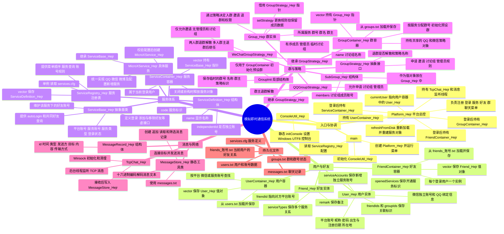
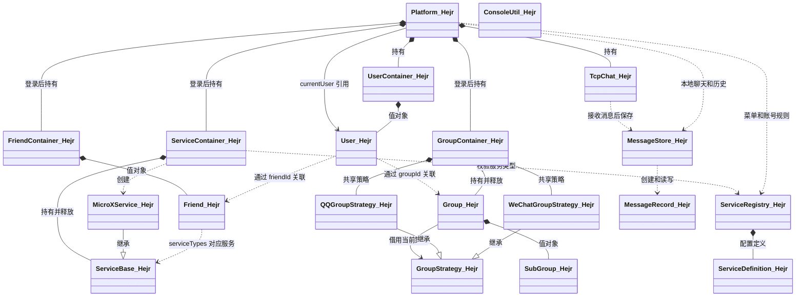

# 模拟即时通信系统架构思维导图

这张图按**入口与协调层 → 数据容器 → 业务对象 → 策略与通信 → 持久化**展开。后面的关系图区分继承、对象所有权和仅保存账号的关联。

## 总体思维导图



## 类和结构体关系图

箭头中的“持有”表示对象生命周期由左侧管理；“引用/标识”表示不负责释放对方对象。继承箭头指向基类。



## 关系中的三个易混点

1. **`currentUser` 是借用指针。**它指向 `UserContainer_Hejr` 的 `vector<User_Hejr>` 中的用户。`refreshFromDisk()` 重新加载用户后，会按平台账号重新查找并更新这个指针。
2. **群策略由群容器统一持有。**多个 `Group_Hejr` 可共用同一个 QQ 或微信策略对象；群本身只保存策略指针，切换模式不会复制或删除策略，也不会重排成员。
3. **用户中的好友和群是标识，不是对象。**`User_Hejr` 保存 `friendIds`、`groupIds`；详细好友记录在当前用户的 `FriendContainer_Hejr`，群对象在 `GroupContainer_Hejr`。服务对象中的好友列表则按服务类型维护。

## 登录到业务操作的调用链

```text
main
  -> ServiceRegistry_Hejr::instance() 读取 services.cfg
  -> Platform_Hejr 构造：加载用户、启动 TCP 接收器
  -> Platform_Hejr::run() 显示登录菜单
  -> Platform_Hejr::login() 验证 User_Hejr 的密码和入口服务
  -> 创建 GroupContainer_Hejr、FriendContainer_Hejr、ServiceContainer_Hejr
  -> ServiceContainer_Hejr::openService() 为每个已开通服务创建 MicroXService_Hejr
  -> ServiceBase_Hejr::autoLogin()；把好友关系装入相应服务对象
  -> 主菜单和各子菜单调用业务对象；修改后保存文件
  -> refreshFromDisk() 在菜单循环中重新加载共享文件并重建服务对象
```

**源码定位：**先看各同名 `.h` 文件中的成员，再看 `Platform_Hejr.cpp` 的 `login`、`refreshFromDisk`、`run`；具体规则看 `Group_Hejr.cpp` 和两个策略实现。
